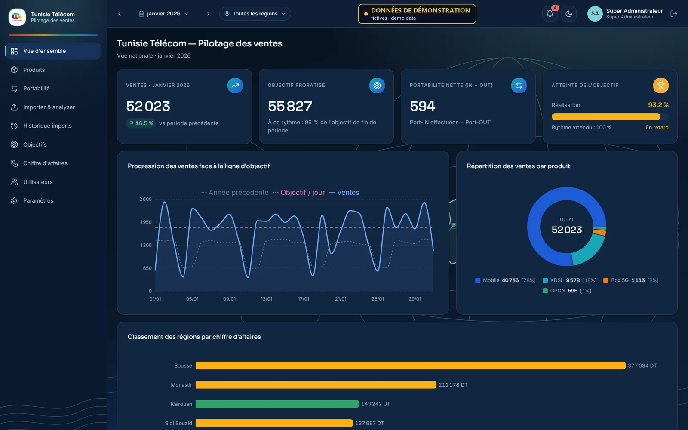
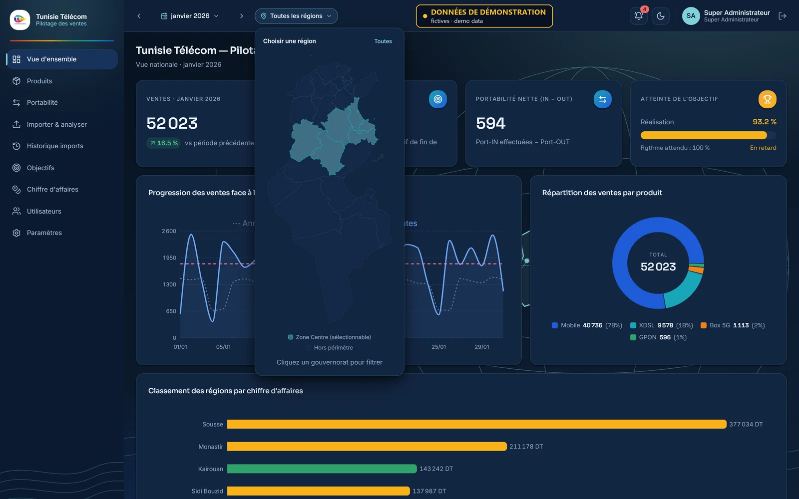
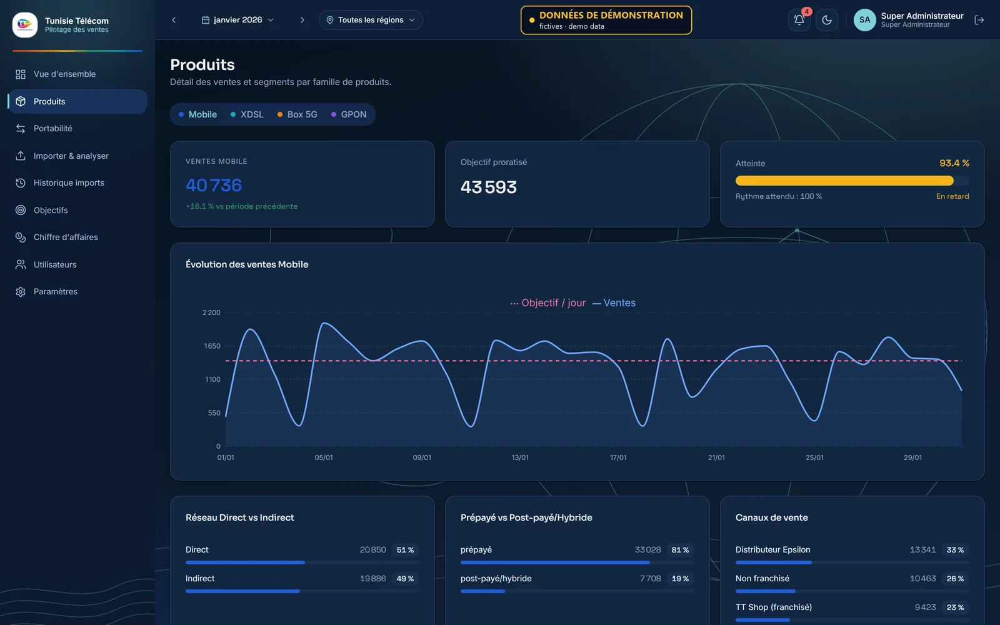
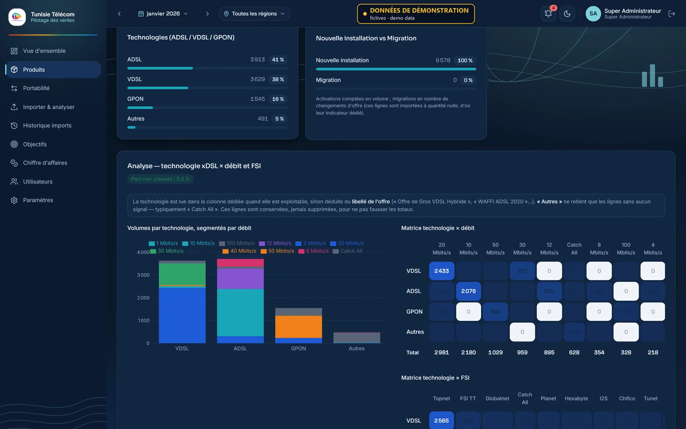
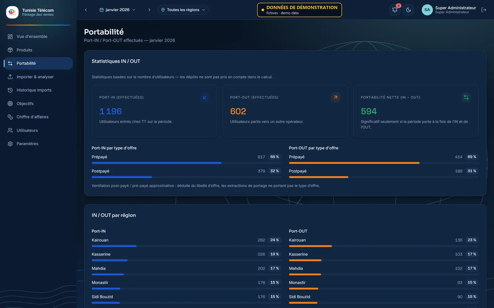
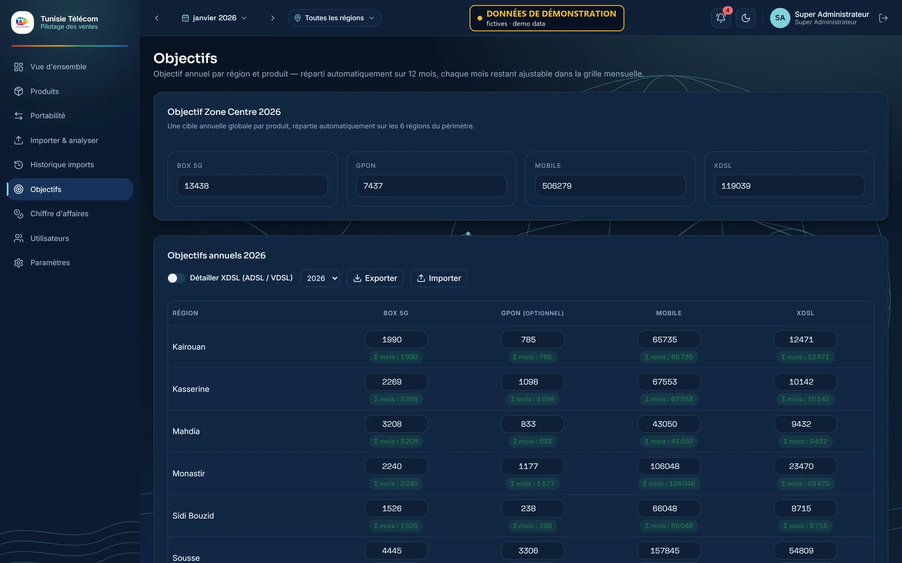
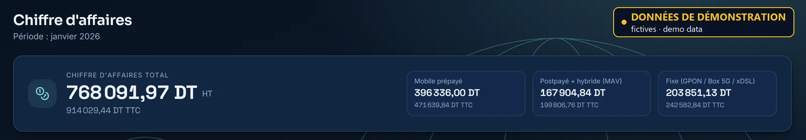
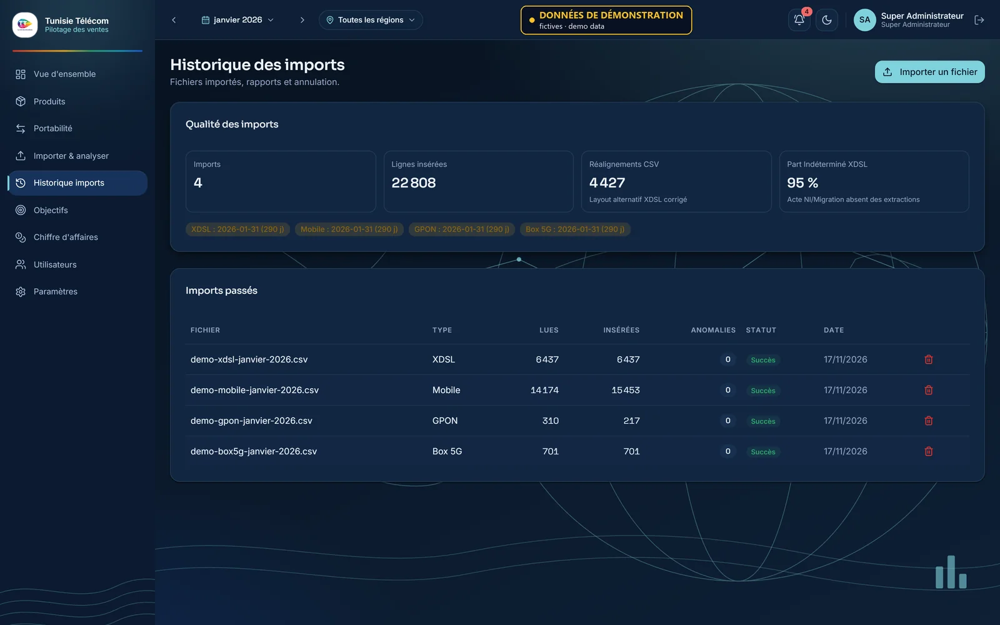
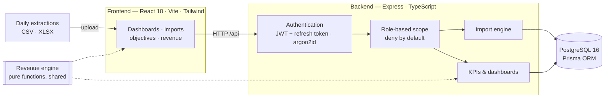
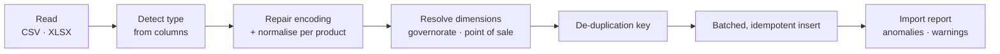

# Pilotage des Ventes — Sales performance platform

**Pilotage des Ventes** is a sales performance platform built for the **central region of Tunisie
Telecom** (the incumbent Tunisian telecom operator), which covers six governorates. Sales teams drop
the raw daily extractions produced by the operator's systems (mobile, xDSL, 5G Box, fibre/GPON,
number portability) and the platform turns them into role-scoped dashboards. These track sales
against objectives, revenue, number portability and the quality of every import.

It was designed and delivered in **one month** (July – August 2026) during a summer internship, by a
team of two students.

> **About this repository.** The application processes confidential commercial data of the host
> company, so the source code is kept in a **private repository**. This page presents the project:
> problem, design, testing and screenshots. **Every screenshot uses fictitious demo data** generated
> for this page: point-of-sale names, distributors and volumes are invented. A walkthrough of the
> source code is available on request.

---

## The problem

Every day, the operator's systems export one statistics file per product family, listing sales point
of sale by point of sale. The data existed, but it arrived too late to be useful:

| Before | Consequence |
|---|---|
| Each file opened, cleaned and merged by hand | Slow, repetitive, error-prone |
| One file per product, each with its own layout | No overall view; comparing two governorates meant manual reconciliation |
| Consolidation only at the end of the period | A gap to the target was discovered when it was too late to act |
| Whole files circulated by e-mail | No access control: everyone saw beyond their own scope |

The goal: **users drop the files exactly as they receive them, and the application does the rest.**

## What the platform does

Three roles see the same screens but not the same data. The scope is enforced **by the server**,
never by the interface.

| Role | Scope |
|---|---|
| Super administrator | The whole region (six governorates) |
| Regional manager | One governorate |
| Point-of-sale manager | One shop, plus daily sales entry |

- **Import & analyse.** Drag and drop `.csv` / `.xlsx` extractions. The file type is detected from
  its columns, and a report lists rows read, rows inserted, anomalies and warnings. Every import is
  traceable and can be rolled back.
- **Overview.** Sales for the period, prorated objective, projected end-of-month result, comparison
  with the previous year, breakdown by product, ranking of governorates, interactive map.
- **Product analyses.** Mobile (prepaid / postpaid, direct / indirect network, Pareto of
  distributors), xDSL (technology × installation type), 5G Box (speed tiers × commitment), GPON
  (funnel from requests filed to completed installations).
- **Number portability.** Ports in and out by donor operator, and the net balance.
- **Objectives.** One annual target per product, for the region or per governorate, split
  automatically over twelve editable months, with Excel import / export.
- **Revenue.** Sales valued excluding and including VAT, prorated to the activation date, with an
  editable price list.

The **achievement gauge** does more than show the percentage achieved: it marks where sales *should*
be given the days elapsed. A delay shows up mid-month, while it can still be recovered.

## Screenshots

The user interface is in French, the language of its users. **Fictitious demo data only.**

**Overview** — KPIs, sales against the daily objective line, breakdown by product, ranking of
governorates

**Governorate filter** — an interactive map of the region scopes every screen

**Product analysis** — Mobile: sales trend, direct vs indirect network, prepaid vs postpaid, sales
channels

**Cross analyses** — xDSL volumes by technology × speed and technology × internet service provider

**Number portability** — ports in and out, net balance, breakdown by offer and by governorate

**Objectives** — one regional target per product, split by governorate and month

**Revenue** — total excluding and including VAT, by business line

**Import history and data quality** — every import with its report; the quality panel shows the
rows realigned automatically

## Architecture

A **modular monolith** in a TypeScript monorepo (npm workspaces). A distributed architecture was
deliberately rejected: for an internal tool serving one regional directorate it would have added
complexity without any benefit.

### The import engine

The hardest part of the project: the files come from different systems and contain irregularities
that the engine absorbs without human intervention.

## Engineering highlights

- **The file type is detected from its columns, never from its name**, which users rename freely. A
  file that matches no known layout is rejected with an explicit report rather than half-imported.
- **Two kinds of broken accents (*mojibake*) are repaired**, including one that standard repair
  tables do not cover. It was found because the same point of sale appeared twice in a ranking under
  two spellings.
- **Re-importing a file adds nothing.** Every row carries a de-duplication key, so a file imported
  twice never inflates a total. A second xDSL layout mixed into the same file is realigned
  automatically and reported.
- **Anomalies are reported, never hidden.** When a classification rule is still provisional (pending
  validation by the IT department), every import report says so.
- **Scope enforced server-side, fail-closed.** Each request is bounded to the user's scope; a regional
  account with no governorate attached sees *nothing* rather than *everything*. This was verified by
  trying to reach another governorate's data by editing the API URL.
- **One revenue engine, run on both sides.** Revenue rules live in a package of pure functions
  shared by the API and the interface, so the two can never disagree. Amounts use exact decimals
  (`Decimal(14,3)` in the database, `decimal.js` in code): no floating-point rounding on money.
- **Extensible data model.** A single fact table with JSONB attributes: product-specific dimensions
  are derived at import time, so a new product family needs no schema migration.
- **Desktop delivery without infrastructure.** The Windows build embeds Node.js and PostgreSQL,
  installs without administrator rights, keeps user data outside the program folder and, on close,
  stops the API, then the database, in that order.
- **Security hygiene.** Passwords hashed with argon2id, short-lived access tokens with an `httpOnly`
  refresh cookie, login rate limiting, Helmet headers, tokens and cookies redacted from HTTP logs.

## Testing and quality

- **429 automated tests** (Vitest, Testing Library, Supertest): 42 on the revenue engine, 261 backend
  unit tests, 74 integration tests on a real PostgreSQL database and 52 React component tests.
- **Validated on real data at scale.** The import engine was replayed on about **925,000 real rows**
  (two years of extractions): no blocking error, no anomaly, de-duplication and idempotence checked.
  These files are confidential and stay out of the repository; the tests that need them skip
  explicitly when the files are absent.
- **Safety guard on integration tests.** They wipe their database between suites, so they refuse to
  run unless the database name contains `_test`.
- **Continuous integration** on every push with GitHub Actions: lint, build, unit tests, integration
  tests against PostgreSQL, frontend type-check / tests / build, desktop build and a dependency audit.

## Delivery

- **Web**: Docker Compose (PostgreSQL, API, nginx serving the interface).
- **Windows desktop app**: Electron with embedded PostgreSQL, NSIS installer, per-user installation.
- **Portable package**: a self-contained folder started with a double-click, with scripts to stop,
  auto-start at logon and reset the demo data.
- Version **v0.1.0** delivered in August 2026, with user documentation, an architecture document and
  a demonstration procedure.

## Tech stack

TypeScript (ESM) · Node.js · Express · Zod · Prisma · PostgreSQL 16 · React 18 · Vite · Tailwind
CSS 4 · Radix UI · Recharts · Motion · decimal.js · SheetJS · Vitest · Testing Library · Electron 33
· electron-builder · Docker · GitHub Actions

About 17,000 lines of TypeScript across 187 source files (API with 11 business modules, interface,
shared revenue engine, desktop shell) and about 6,200 lines of tests.

## Development

Designed and developed by **Fayed Aziz Bouslama** (ISSAT Sousse, computer systems engineering — IoT
& embedded systems) and **Mohamed Saad Edine Gharbi** (ISG Sousse, business computing — business
intelligence) during a summer internship at Tunisie Telecom's Central Region Directorate in
Monastir, supervised by the head of its commercial subdivision. Fayed led the import pipeline and
runtime reliability; Mohamed led data modelling, KPI definitions, objective rules and dashboard
design.

Built with the help of an AI coding assistant (Claude, by Anthropic). The private repository's
history records every change and its rationale.

---

© 2026 Fayed Aziz Bouslama and Mohamed Saad Edine Gharbi. All rights reserved. Screenshots and text
may not be reused without permission. "Tunisie Telecom" and its logo belong to their owner and appear
only to identify the host organisation.
